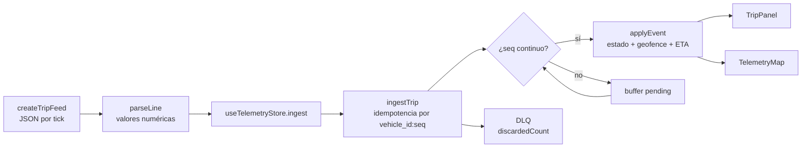

# Modo Chofex: pipeline de eventos de viaje en CubeOS

Este modo es un ejercicio de aprendizaje: reproduce, con datos sintéticos y sin
infraestructura, los conceptos que Chofex aplica a la telemetría de camiones.
No es código de Chofex ni usa sus servicios.

## Cómo probarlo

```bash
pnpm dev
```

Entrar a `/visor` y pulsar **Simular viaje**. El productor emite una línea JSON
cada 500 ms con `vehicle_id`, `seq`, `ts`, `lat`, `lon` y `msg_code`. Esas líneas
entran por el mismo `ingest` que usa la placa por USB, así que el mapa existente
muestra el recorrido y el panel nuevo muestra el estado del viaje.

## Flujo

```
createTripFeed → parseLine → useTelemetryStore.ingest → ingestTrip → TripPanel + TelemetryMap
```



- `trip-feed.ts`: productor sintético. Inyecta duplicados (cada 5 ticks) y una
  coordenada imposible (cada 7 ticks) para que se vea cómo reacciona el pipeline.
- `trip-pipeline.ts`: reducidor puro. No depende de React ni de AWS.
- `trip-panel.tsx`: panel en el visor con estado, procedencia, contadores, ETA y
  distancia al destino.

## Conceptos y dónde están

| Concepto | Implementación aquí | Equivalente en la arquitectura autodeclarada de Chofex |
|---|---|---|
| Ingesta de eventos | Líneas JSON → `parseLine` → store | Kinesis + Lambda |
| Idempotencia | clave `vehicle_id:seq` en `seen` | dedupe antes de escribir el estado |
| Orden por vehículo | `lastSeq` + buffer `pending` | orden dentro del shard de Kinesis |
| Estado del viaje | `en_ruta` / `parado` / `en_destino` | máquina de estados del viaje |
| Geofence y ETA | distancia haversine + velocidad media | PostGIS + OSRM |
| Procedencia | `source` y `confidence` por evento | GPS vs. mensaje del operador |
| DLQ | `discardedCount` para líneas inválidas | cola de mensajes fallidos |

## Qué NO cubre

- No hay Kinesis, Lambda ni PostgreSQL/PostGIS reales: la distancia se calcula
  en memoria con haversine y el stream es un `setInterval`.
- No hay WhatsApp ni LLM: `msg_code` simula el mensaje de un operador.
- No es un benchmark de rendimiento; es una herramienta para entender el flujo.

## Tests

```bash
pnpm test
```

Los tests usan `node --test` sobre datos reales del pipeline y del productor;
cubren duplicados, orden, geofence, parada, procedencia y descartes.
