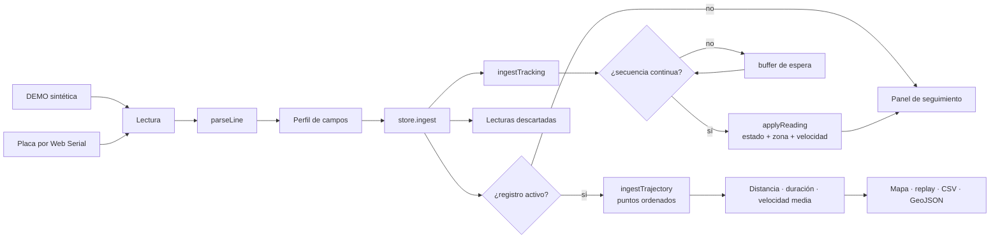

# Seguimiento de proyectos

El visor puede mostrar el estado de seguimiento de una placa con GPS, sea un
CanSat, un CubeSat, un robot o cualquier otro proyecto. El estándar es el mismo:
una lectura con `project_id`, `seq`, `lat` y `lon`.

## Cómo probarlo

```bash
pnpm dev
```

Entrar a `/visor` y pulsar **Simular placa**. La DEMO emite una lectura cada
500 ms por el mismo `ingest` que usa el puerto serial. Al iniciarla se empieza
también el registro de trayectoria; al detenerla, el registro termina y los
puntos siguen disponibles para reproducirlos o exportarlos.

## Flujo



## Qué resuelve

| Situación | Comportamiento |
| --- | --- |
| La misma lectura llega dos veces | Se contabiliza como duplicada y no se aplica dos veces |
| Llega la lectura 3 antes que la 1 y la 2 | Se guarda en espera y se aplica en orden al completar la secuencia |
| La placa sale de la zona de operación | El estado pasa a `fuera_de_zona` |
| Varias lecturas seguidas sin movimiento | El estado pasa a `sin_movimiento` |
| Una coordenada imposible | Se cuenta como descartada y no altera la posición |

La clave de idempotencia es `project_id:seq`. La zona de operación es opcional:
si no se configura, el panel solo muestra posición, velocidad y estado.

## Registro de trayectoria

Cada lectura válida con `lat`/`lon` se convierte en un punto
`{t, seq, project_id, lat, lon, temp}`. El acumulador (`trajectory.ts`) reutiliza
el mismo dedupe y orden por secuencia que el seguimiento, para que un punto no se
cuente dos veces ni se dibuje fuera de orden. Con esos puntos se calculan
distancia total (haversine entre consecutivos), duración y velocidad media.

El registro arranca y termina con botones explícitos; la DEMO lo hace
automáticamente al iniciarse y detenerse. Los puntos se dibujan en el mapa
existente, se pueden recorrer con el control *Reproducir* y se exportan a CSV o
GeoJSON (`LineString`), sin backend ni cuentas.

| Situación | Comportamiento |
| --- | --- |
| Llega una lectura repetida | Se cuenta como duplicada y no agrega punto |
| Llega la secuencia 3 antes que la 1 y la 2 | Se guarda en espera y se ordena al completarse |
| Una coordenada imposible | Se descarta y no altera la trayectoria |
| Se mueve el control de reproducción | El mapa muestra solo los puntos hasta ese momento |

## Límites

Esto corre en el navegador, sin backend ni cuentas. No hay servicios remotos,
no calcula tiempo estimado de llegada y la DEMO no son mediciones reales. La
trayectoria vive solo en memoria: se pierde al recargar o cerrar la pestaña, así
que conviene exportarla antes. No hay persistencia hasta que exista login.
