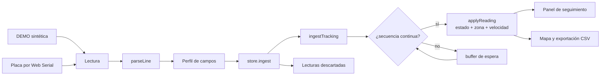

# Seguimiento de proyectos

El visor puede mostrar el estado de seguimiento de una placa con GPS, sea un
CanSat, un CubeSat, un robot o cualquier otro proyecto. El estándar es el mismo:
una lectura con `project_id`, `seq`, `lat` y `lon`.

## Cómo probarlo

```bash
pnpm dev
```

Entrar a `/visor` y pulsar **Simular placa**. La DEMO emite una lectura cada
500 ms por el mismo `ingest` que usa el puerto serial, así que el mapa existente
dibuja la trayectoria y el panel nuevo muestra el estado del seguimiento.

## Flujo



## Qué resuelve

| Situación | Comportamiento |
| --- | --- |
| La misma lectura llega dos veces | Se contabiliza como duplicada y no se aplica dos veces |
| Llega la lectura 3 antes que la 1 y la 2 | Se guarda en espera y se aplica en orden al completar la secuencia |
| La placa sale de la zona de operación | El estado pasa a `fuera_de_zona` |
| Varias lecturas seguidas sin movimiento | El estado pasa a `sin_movimiento` |
| Una coordenada imposible | Se cuenta como descartada y no altera la posición |

La clave de idempotencia es `project_id:seq`. La zona de operación es opcional:
si no se configura, el panel solo muestra posición, velocidad y estado.

## Límites

Esto corre en el navegador, sin backend ni cuentas. No hay servicios remotos,
no calcula tiempo estimado de llegada y la DEMO no son mediciones reales.
